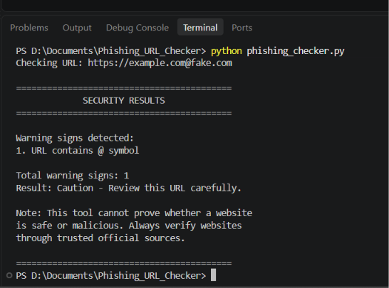
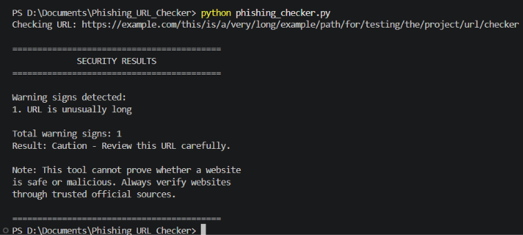

# EWB Phishing URL Awareness Checker

## Overview

The EWB Phishing URL Awareness Checker is a Python-based mini project that checks website URLs for common phishing warning signs. It helps users understand suspicious URL patterns through simple text-based checks.

The project also includes a web interface developed using Streamlit, allowing users to check URLs through a browser.

## Features

The program checks for six warning signs:

1. Presence of the `@` symbol.
2. URL length greater than 100 characters.
3. IPv4-looking hostname.
4. Five or more hostname segments.
5. Punycode pattern (`xn--`).
6. Use of HTTP instead of HTTPS.

### Improvements

- **Multiple URL checking:** Users can check multiple URLs without restarting the program. Type `q` to quit.
- **Clear warning summary:** The program displays a "REVIEW CAREFULLY" message when warning signs are detected.
- **Malformed URL handling:** The program handles certain malformed URLs without crashing.

### Web Application

- Browser-based interface developed using Streamlit.
- Users can enter a website URL.
- Displays detected warning signs.
- Shows a clear security result.
- Does not open or visit websites.

## Requirements

- Python 3.10 or later.
- Streamlit.
- Python built-in libraries.

## How to Run

### Windows

Open the terminal in the project folder and install the required package:

```bash
pip install -r requirements.txt
```

Run the command-line application:

```bash
python phishing_checker.py
```

### Mac / Linux

Install the required package:

```bash
pip3 install -r requirements.txt
```

Run the command-line application:

```bash
python3 phishing_checker.py
```

### Run the Web Application

To start the Streamlit web application, run:

```bash
streamlit run app.py
```

The application will open in your web browser.

## Example Output

```text
EWB PHISHING URL AWARENESS CHECKER

Enter a website URL:
http://192.0.2.10/account

Warning signs detected:
1. URL uses an IP address instead of a domain name.
2. URL uses HTTP instead of HTTPS.

Result: REVIEW CAREFULLY.
This URL contains warning signs.
```

## Testing

The program was tested using five sample URLs.

| # | Test Case | Expected Result | Status |
|---|---|---|---|
| 1 | Normal example URL | No listed warning signs | PASS |
| 2 | IP address URL | IP and HTTP warnings | PASS |
| 3 | URL containing `@` | @ and HTTP warnings | PASS |
| 4 | URL with many hostname segments | Hostname segments warning | PASS |
| 5 | Punycode URL | Punycode warning | PASS |

## Screenshots

### Sample Run



### Test Results



## Improvements Explained

1. **Multiple URL checking:** Added a loop so users can enter multiple URLs and type `q` to exit.
2. **Clear warning summary:** Added a clear review message when warning signs are found.
3. **Malformed URL handling:** Added error handling for certain malformed URLs to prevent the program from crashing.

## Limitations

- The program checks URL text only.
- It does not visit or open websites.
- It does not scan websites for malware.
- It cannot guarantee that a website is safe or malicious.

## Ethical Use

This project is developed for educational cybersecurity awareness. It uses sample URL strings and does not collect credentials, deceive users, or perform unauthorized website testing.

## Author

Sachin  
Mini Project  
EWB Courses
